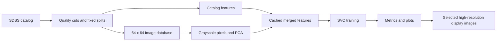

# Galaxy classification with images and SDSS photometry

Classify galaxies as **elliptical (0)** or **spiral (1)** using an RBF support-vector classifier. The model combines grayscale image features reduced with PCA and extinction-corrected SDSS catalog features. Downloads, preparation, feature extraction, training and plotting run separately, so changing SVC parameters does not require downloading images or fitting PCA again.

**Existing users:** older hips2fits downloads contained a field-of-view unit error. If you used those images, follow the [migration guide](DOWNLOAD_GUIDE.md#a-repair-an-existing-sample-without-resampling-it-powershell) before interpreting results. Increasing display resolution alone does not fix the affected training data.

## Documentation

| Guide | What it covers |
|---|---|
| [Presentation report](docs/PROJECT_REPORT.md) | Brief account of collection, features, splits, algorithms and evaluation |
| [Setup](docs/SETUP.md) | Windows/PowerShell with uv, Linux/macOS, tests and network prerequisites |
| [Complete workflow](docs/WORKFLOW.md) | Commands from catalog download to training, plots, retraining and larger samples |
| [Data and model](docs/DATA_AND_MODEL.md) | Catalog fields, image units, cleaning cuts, feature formulas, PCA, SVC and scientific limits |
| [Results and plots](docs/RESULTS.md) | Saved artifacts, confusion matrices, ROC/AUC, correlations and higher-resolution galleries |
| [Script reference](docs/SCRIPTS.md) | Every module, command-line defaults, key functions, inputs and outputs |
| [Troubleshooting](docs/TROUBLESHOOTING.md) | Missing files, duplicate IDs, download errors, cache mismatches and Windows issues |
| [Download audit and migration](DOWNLOAD_GUIDE.md) | Verified source details, FOV correction and commands preserving an existing sample |

Start with **Setup**, then follow **Complete workflow** in order. All commands run from the repository root. The main walkthrough uses one consistent set of filenames and explicit paths; changing a sample name requires changing its downstream database, feature cache and run paths too.

## Setup on Windows

```powershell
# Install uv once if it is not available; then reopen PowerShell.
winget install --id astral-sh.uv -e
```

```powershell
git clone https://github.com/ignaciojjb/final_project.git
cd final_project
uv python install 3.12
uv venv --python 3.12
uv pip install -r requirements-ml.txt
.\.venv\Scripts\python.exe -m unittest discover -s tests -v
```

If the repository already exists, enter its directory and run `git pull origin main` instead of cloning. The tests use temporary synthetic data and do **not** create a real training sample or feature cache. Continue with the [workflow](docs/WORKFLOW.md) after they pass.

## How the stages connect



PCA, imputation and scaling are fitted on training rows only. Validation supports model selection; test is reserved for the final assessment. High-resolution gallery downloads are separate display artifacts and never replace training images.

## Repository layout

```text
scripts/                Independent pipeline stages and helpers
tests/                  Synthetic unit and integration tests
docs/                   Setup, workflow, reference and interpretation
DOWNLOAD_GUIDE.md       Source audit and migration instructions
README_ML.md            Model documentation entry point
requirements-ml.txt     Pinned direct dependencies
setup_environment.sh    Cloud Linux setup helper
datasets/               Local catalogs and images (created by you; ignored by Git)
artifacts/              Local caches, models and plots (ignored by Git)
```

The repository contains source and tests, not a bundled real catalog, trained scientific model or published accuracy benchmark.

## Validation and scope

The current suite has 18 tests covering the pipeline, FOV units, joins, photometric features, caching, Windows-safe SQLite closure, plotting and ROC scores. A separate live smoke check downloaded 12 real objects and their corrected images, ran a two-component model and generated plots. That tiny check establishes execution, not classification performance. The normal 64-component path is covered synthetically and requires a larger real sample.

This is a starter workflow for about 2,000 objects. The public catalog downloader selects the first qualifying IDs per class, not a representative random sample of the entire survey. Images may contain neighboring objects, and catalog morphology labels are not independently verified truth. See [limitations](docs/DATA_AND_MODEL.md#scientific-and-computational-limits) before drawing scientific conclusions.
